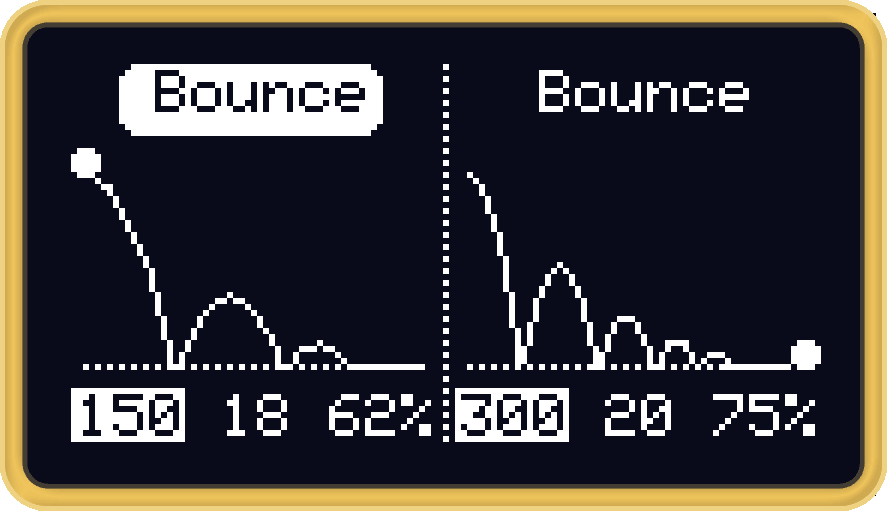

# Buds

Two independent clock processors in one module: coin flip, toggle, swing, clock divider and
bouncing ball.



## What it does

The module is split into two sides. Side A is clocked from the RST jack, side B from the CLK
jack. Each side runs one of five modes:

- **Buds** (probability): on every clock a coin flip decides. With the set probability the main
  output fires, otherwise the inverted output fires.
- **Toggle:** every clock flips the main output; the inverted output is always the opposite.
  Both stay where they are until the next clock (gates).
- **Swing:** every clock gives a trigger on the main output, and every second one is moved later
  or earlier by the swing amount. The delay is worked out from the measured clock period.
- **Factor:** clock divider 1-8. The main output fires on every Nth clock.
- **Bounce:** a clock drops a ball. Every impact gives a trigger on the main output, faster and
  faster until the ball comes to rest, and while the ball rises after an impact the inverted
  output is high (rise gate).

Each side also has a clock output that fires on every step (in Bounce on every clock). All
triggers are 12 ms long (Bounce impacts can be shorter, see below) and timed by a hardware timer,
so the two sides run at any tempo, independent of each other and of the display.

The left half of the display belongs to side A, the right half to side B. The selected side's
mode name is highlighted. In Bounce the half shows the ball's path for the current values: from
the top on the left the fall, then one arc per bounce, as wide as its flight and as high as the
bounce, the whole burst across the half. During a burst the ball moves along it in real time;
otherwise it lies at the end of the path. Below it are Start, Min and Rest (ms, ms, %); the value
that turning changes is highlighted. While a ball is in the air the display refreshes every
30 ms, otherwise as in the other modes.

## Controls

| Action | Function |
|---|---|
| Click | select side A or side B |
| Press + turn | next mode for the selected side: Buds, Toggle, Swing, Factor, Bounce |
| Turn | change the selected side's value (see below) |
| Long press (0.4 s) | flip the toggle state of the selected side (for Toggle mode); in Bounce: next value (Start, Min, Rest) |

What turning does in each mode:

| Mode | Turn |
|---|---|
| Buds | probability 0-100 % (2 % steps, turn faster for bigger steps); 50 % after the first start |
| Toggle | flips the toggle state by hand |
| Swing | swing amount 0-70 %; 50 % = straight (no swing) |
| Factor | divider 1-8 |
| Bounce | the highlighted value: Start 10-500 ms (the arc the ball is dropped from, 2 ms steps), Min 5-80 ms (shortest flight), Rest 30-95 % (bounce); turn faster for bigger steps; 150 ms, 18 ms and 62 % after the first start |

## Inputs and outputs

| | Side A | Side B |
|---|---|---|
| Clock input | RST | CLK |
| Main output | OUT2 | OUT5 |
| Inverted output | OUT1 | OUT4 |
| Clock output | OUT3 | OUT6 |

What the outputs do in each mode:

| Mode | Main output | Inverted output | Clock output |
|---|---|---|---|
| Buds | 12 ms trigger when the coin flip says yes | 12 ms trigger when it says no | 12 ms trigger on every clock |
| Toggle | gate, flips on every clock | the opposite of main | 12 ms trigger on every clock |
| Swing | 12 ms trigger on every (swung) step | stays low | 12 ms trigger on every (swung) step |
| Factor | 12 ms trigger on every Nth clock | stays low | 12 ms trigger on every clock |
| Bounce | trigger on every impact (every clock drops the ball again): 12 ms, at most half the flight that follows | rise gate: high from each impact until the ball is at the top of its arc (half the flight that follows) | 12 ms trigger on every clock |

Swing in detail: the clock period is measured between rising edges. The step on the beat plays on
the clock, the off-beat step is placed at 2 x swing x clock period after it: at 50 % it lands on
the next clock (straight), above 50 % later, below 50 % earlier. After a pause of 2 s or more the
period is measured again, and until then the steps play straight on the clock.

Bounce in detail: a clock drops the ball from the top of a Start ms arc: it falls for Start/2 to
the first impact. After each impact it flies the previous flight x Rest (the first flight is
Start x Rest; Rest is how much of its speed the ball keeps at a bounce), so the impacts come
closer and closer together. When the next flight would be shorter than Min, the ball stays down
and that impact was the last; if Start x Rest is already shorter than Min, a clock gives a single
impact. A clock during a burst picks the ball up and drops it again: what was still to come is
cancelled, the rise gate goes low, and the first impact comes Start/2 after that clock. The rise
gate is high from each impact until the ball reaches the top of its arc, half of the flight that
follows, so it gets shorter as the ball loses energy; after the last impact there is none. With
the starting values (150 ms, 18 ms, 62 %) a clock gives five impacts, at about 75, 168, 226, 261
and 284 ms, with rise gates until about 121.5, 197, 243.5 and 272.5 ms; with Start 500 ms, Min
5 ms and Rest 95 % the ball bounces 90 times in about 9.7 s. The times are kept to a fraction of
a timer tick, so long bursts do not drift. An impact's trigger is 12 ms, but at most half the
flight that follows, so fast impacts stay separate triggers; the last impact has the full 12 ms.

The channel LEDs show the outputs.

## Settings

The mode, probability, swing amount, divider and the three Bounce values of both sides are saved
3 s after the last change and come back at power-up. Settings saved by an earlier Buds version
are kept; Bounce then starts with 150 ms, 18 ms and 62 %. The toggle state, the selected side and
the selected Bounce value are not saved.

## Flashing

The easiest way is the [A-RYTH-MATIK firmware uploader](https://dl.modulove.io/arythmatik/) in
Chrome. The same file runs on an Arduino Nano and on LGT8F328P Nano boards; on an LGT8F328P
board leave "Use new bootloader" unchecked. Each release also has a `reversed` file for modules
whose encoder turns the wrong way round.

Building it yourself (Arduino IDE or arduino-cli):

- Board "Arduino Nano"; for LGT8F328P boards choose the processor "ATmega328P (Old Bootloader)".
- libModulove is a git submodule in `src/libmodulove`: clone the repository with
  `git clone --recursive` (or run `git submodule update --init`).
- Libraries: FastGPIO (Pololu), EncoderButton, Adafruit GFX Library, Adafruit SSD1306.
- Options: `ENCODER_REVERSED` (reverses the encoder); uncomment it at the top of the sketch or
  pass it as a `-D` flag. The sketch also has `ROTATE_PANEL` (upside-down panel), but
  libModulove's rotated pin table puts OUT4 on the wrong pin (D1 instead of D5), so it needs a
  fix there first.
- The release builds pass `-DSSD1306_NO_SPLASH`: it leaves out the display library's unused
  splash logo (about 1.2 KB). Without it (for example in the Arduino IDE) the build still works,
  it is just bigger.
- Builds for LGT8F328P boards must stay below 29,696 bytes, see
  [AUTOMATED_BUILD.md](../../AUTOMATED_BUILD.md).

```
arduino-cli compile -b arduino:avr:nano --build-property "build.extra_flags=-DSSD1306_NO_SPLASH" --build-property upload.maximum_size=29696 ARYTHMATIK_Buds
```

## Credits

Modulove. Uses [libModulove](https://github.com/awonak/libModulove) by Adam Wonak.
