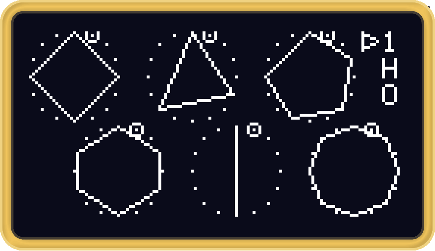

# Euclid

Six-channel Euclidean rhythm generator, the main firmware of the A-RYTH-MATIK.



## What it does

- Six channels, each plays a Euclidean rhythm: a number of hits spread evenly over 16 steps.
- Per channel: hits, offset, length, mute and probability.
- Runs from an external clock at CLK or from the internal clock (40-240 BPM, one step per 16th note).
- 20 presets and 20 memory slots.
- Random functions: re-roll all channels at once, or let the module do it every few bars (random advance).
- The steps are played directly from the clock interrupt, so every hit is an exact 10 ms trigger, even while the display redraws.

**The display:** six circles, one per channel (top row channels 1-3, bottom row 4-6). The dots
are the steps of the pattern, lines connect the hits, and the moving dot is the current step
(filled when it is a hit). A muted channel shows an `M`. The right edge shows the selected
top-menu item, the left edge the channel parameter you are editing.

## Controls

Turn faster for bigger steps. A long press means hold for about 0.4 s, then release.

### Top menu

Turn to step through the items (shown at the right edge):

| Item | Display | Click | Long press | Press + turn |
|---|---|---|---|---|
| Channel 1-6 | `1` ... `6` | edit this channel's parameters | mute / unmute the channel | change the channel's hits |
| Random advance | `RND` | re-rolls channel 1 only and unmutes it (rarely changes the pattern) | - | number of bars between re-rolls |
| Random | `X`, `RAND` | re-roll all channels (and unmute them) | - | clockwise: like a click; counter-clockwise: re-roll including random mutes |
| Save | `S`, `SAVE` | open / close the slot page | save (page open) | - |
| Load | `L`, `LOAD` | open / close the slot page | load (page open) | - |
| Preset | `P`, `PRST` | open / close the preset page | load the preset (page open) | - |
| Clock | `EXT` or `INT`, `*CLK` | open / close the tempo page | switch internal / external clock (page closed) | - |
| Reset | `R`, `RSET` | all channels start again from step 1 with the next clock | - | - |
| Mute | `M`, `MUTE` | mute all channels (shows `MUTE`), click again to unmute | - | mute (clockwise) or unmute (counter-clockwise) channels one by one |

Mute, press + turn: if this leaves every channel muted, all are unmuted again, and the other way round.

### Channel parameters

Click a channel to edit it. Each click moves to the next parameter, after `PROB` you are back in
the top menu. A long press goes one parameter back. Turn to change the value; press + turn jumps
to the same parameter of another channel.

| Parameter | Turn |
|---|---|
| `HITS` | number of hits, 0-16 |
| `OFFS` | offset: shifts the pattern by 0-15 steps |
| `LIMI` | length: the channel starts over after this many steps (up to 16) |
| `MUTE` | mute / unmute |
| `RSET` | puts this channel's playhead back to its first step |
| `RAND` | re-rolls hits and offset of this channel (and unmutes it) |
| `PROB` | probability 0-100 % that a hit plays (the display shows bars for all channels) |

- Values wrap around at the ends (hits 16 goes to 0, probability 100 goes to 0).
- The hits are always spread over 16 steps. A shorter length makes the channel start over
  earlier, so hits after the length are not played.
- Re-rolls: how likely hits or offset change is fixed per channel. Channels 1 and 2 rarely
  change, channels 3-6 more often. Random mutes never mute channel 1.

### Random advance

While the top menu sits on `RND`, all channels are re-rolled, including random mutes, every few
bars (1 bar = 16 steps). Press + turn sets the number of bars: 4, 6, 8, 12 or 16 (4 after
power-up). The bar at the left edge shows the progress. It stops as soon as you move to another
item.

### Pages (Save, Load, Preset, Clock)

- **Save / Load:** turn to choose slot 1-20, long press to save / load.
- **Preset:** turn to choose a preset, long press to load it. Loading a preset also sets its tempo.
  Presets: Techno, Funk, Swing, Samba, Waltz, BossaN, Bell, Gen, Gahu, Threes, Aksak, Rumba,
  Clave, Zarbi, Nawkht, FumeF, Djembe, Gahu44, Takita, ClkDiv.
- **Clock:** with the internal clock, turn to set the tempo (40-240 BPM). With an external clock
  the page shows the incoming tempo (the clock counted as 16th notes), or "Patch CLK or long
  press for INT CLK" before a clock has come in.

A click closes a page; it also closes by itself after 5 s without encoder activity.

## Inputs and outputs

| Jack | Function |
|---|---|
| CLK | each rising edge plays the next step on all channels (ignored while the internal clock is on) |
| RST | rising edge: all channels start again, the next clock plays step 1 (a reset together with a clock plays step 1 right away) |
| OUT1-OUT6 | a 10 ms trigger on every hit of channel 1-6 |

The channel LEDs flash with the hits. The CLK LED flashes on every step (internal or external clock).

## Settings

Nothing is saved automatically: save to a slot when you like what you hear.

- A slot holds hits, offset, length, mute and probability of all six channels, plus the tempo
  and the clock source (internal / external).
- At power-up the module loads the slot you last saved to.
- On the first start, the 20 slots are filled with the 20 presets and slot 1 (Techno) is loaded.
  Other firmware stores its settings in the same memory, so after running another firmware Euclid
  usually starts fresh like this.
- The random advance setting is not saved.

## Flashing

The easiest way is the [A-RYTH-MATIK firmware uploader](https://dl.modulove.io/arythmatik/) in
Chrome. The same file runs on an Arduino Nano and on LGT8F328P Nano boards; on an LGT8F328P
board leave "Use new bootloader" unchecked. Each release also has a `reversed` file for modules
whose encoder turns the wrong way round.

Building it yourself (Arduino IDE or arduino-cli):

- Board "Arduino Nano"; for LGT8F328P boards choose the processor "ATmega328P (Old Bootloader)".
- Libraries: FastGPIO (Pololu), EncoderButton, Adafruit GFX Library, Adafruit SSD1306.
- Options: `ENCODER_REVERSED` (reverses the encoder), `ROTATE_PANEL` (upside-down panel),
  `DISABLE_BOOT_LOGO`. Uncomment them at the top of the sketch or pass them as `-D` flags.
- The release builds pass `-DSSD1306_NO_SPLASH`: it leaves out the display library's unused
  splash logo (about 1.2 KB). Without it (for example in the Arduino IDE) the build still works,
  it is just bigger.
- Builds for LGT8F328P boards must stay below 29,696 bytes, see
  [AUTOMATED_BUILD.md](../../AUTOMATED_BUILD.md).

```
arduino-cli compile -b arduino:avr:nano --build-property "build.extra_flags=-DSSD1306_NO_SPLASH" --build-property upload.maximum_size=29696 ARYTHMATIK_Euclid
```

## Credits

Modulove & friends, based on [HAGIWO](https://www.youtube.com/@HAGIWO)'s
[6CH Euclidean rhythm sequencer](https://note.com/solder_state/n/n433b32ea6dbc). Contributions by
Adam Wonak and Kassandra Karan, boot logo by bkrsmdesign. Thanks to
[Testbild-synth](https://github.com/Testbild-synth) and [mzuelch](https://github.com/mzuelch)
for their inspiration and earlier work (see the [main README](../../README.md)).
