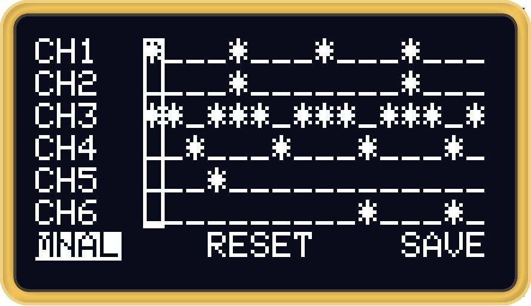

# Gate-seq

Six-channel, 16-step gate sequencer after HAGIWO's 6CH gate sequencer: program the steps by hand
(MANUAL) or let built-in drum patterns play (AUTO).



## What it does

- 6 channels x 16 steps. Every clock pulse moves to the next step.
- The gates follow the clock: an output is high exactly as long as the clock pulse, on the steps
  that are switched on for its channel.
- **MANUAL** mode: switch steps on and off, mute channels, save the pattern.
- **AUTO** mode: plays built-in patterns from four genres (TECHNO, DUBTCN = dub techno, HOUSE,
  HALF = half-step), each with a fill-in variant, and picks a new pattern at random after a set
  number of bars.
- There is no internal clock: Gate-seq needs a clock at CLK.

**The display:** one row per channel (CH1-CH6), `*` = step on, `_` = step off. A muted channel's
row is empty. A tall frame marks the current step. The bottom row holds the options.

## Controls

Turn to move the cursor (it wraps around at the ends), click to act on the item under the
cursor. There is no long press and no press + turn.

### MANUAL mode

The cursor runs through the steps of CH1 to CH6 (16 each), then `MNAL`, `RESET`, `SAVE`, then
the channel names CH1-CH6. At power-up it sits on `MNAL`.

| Cursor on | Click |
|---|---|
| a step (framed) | switches the step on / off |
| `MNAL` | switches to AUTO mode |
| `RESET` | jumps back to step 1 at once |
| `SAVE` | saves the six patterns (this also jumps back to step 1) |
| a channel name (highlighted) | mutes / unmutes the channel |

### AUTO mode

The cursor runs through `AUTO`, the genre, `FilIN`, `REP`, `SW` and the channel names CH1-CH6.
Steps can't be edited in AUTO mode.

| Cursor on | Click |
|---|---|
| `AUTO` | back to MANUAL mode; the saved pattern is loaded again |
| genre | next genre: TECHNO, DUBTCN, HOUSE, HALF |
| `FilIN:Y` / `FilIN:N` | fill-in on / off |
| `REP:x/y` | bars per pattern: 4, 8, 16, 32 or ET (endless) |
| `SW:x/y` | rounds before a new random pattern: 2, 4, 8, 16 or ET (endless) |
| a channel name | mutes / unmutes the channel |

How AUTO plays: a pattern repeats for REP bars (1 bar = 16 steps). With fill-in on, the last of
these bars plays the pattern's fill-in variant. After SW such rounds a new pattern is picked at
random from the genre. `REP:x/y` and `SW:x/y` show where you are (current / total). A new genre
takes effect at the next fill-in or pattern change.

## Inputs and outputs

| Jack | Function |
|---|---|
| CLK | rising edge = next step. An output is high while CLK is high, if its channel's current step is on and the channel isn't muted |
| RST | rising edge: back to the start; the outputs stay low until the next clock, which plays step 1 |
| OUT1-OUT6 | gates of CH1-CH6 |

The channel LEDs follow the outputs. The CLK LED is not used.

## Settings

- `SAVE` (MANUAL mode) stores the six patterns. They are loaded at power-up and when you go from
  AUTO back to MANUAL.
- Mutes, the mode and the AUTO settings are not saved.
- Until you have saved once, the patterns show whatever is in the memory (often all steps on, or
  leftovers from another firmware). Clear the steps you don't want and `SAVE`.

## Flashing

The easiest way is the [A-RYTH-MATIK firmware uploader](https://dl.modulove.io/arythmatik/) in
Chrome. The same file runs on an Arduino Nano and on LGT8F328P Nano boards; on an LGT8F328P
board leave "Use new bootloader" unchecked. Each release also has a `reversed` file for modules
whose encoder turns the wrong way round.

Building it yourself (Arduino IDE or arduino-cli):

- Board "Arduino Nano"; for LGT8F328P boards choose the processor "ATmega328P (Old Bootloader)".
- Libraries: Encoder (PJRC), Adafruit GFX Library, Adafruit SSD1306.
- Options: `ENCODER_REVERSED` (reverses the encoder); `PANEL_USD` turns the display upside down
  (only the display, the jacks are not remapped). Uncomment them at the top of the sketch or pass
  them as `-D` flags.
- The release builds pass `-DSSD1306_NO_SPLASH`: it leaves out the display library's unused
  splash logo (about 1.2 KB). Without it (for example in the Arduino IDE) the build still works,
  it is just bigger.
- Builds for LGT8F328P boards must stay below 29,696 bytes, see
  [AUTOMATED_BUILD.md](../../AUTOMATED_BUILD.md).

```
arduino-cli compile -b arduino:avr:nano --build-property "build.extra_flags=-DSSD1306_NO_SPLASH" --build-property upload.maximum_size=29696 ARYTHMATIK_Gate-seq
```

## Credits

Based on [HAGIWO](https://www.youtube.com/@HAGIWO)'s 6CH gate sequencer
([article](https://note.com/solder_state/n/n17c69afd484d),
[video](https://www.youtube.com/watch?v=YszdC8YdFl0)). A-RYTH-MATIK version by Modulove & friends,
with a contribution by Kassandra Karan.
