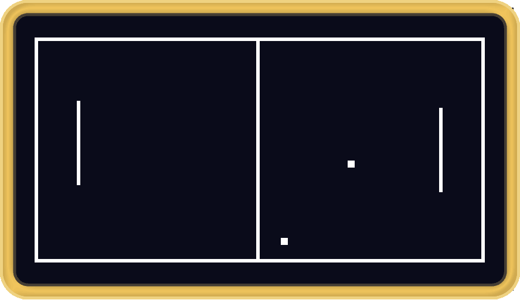

# Ping

_Ping was called Pong up to v1.1.0._

A playable ping-pong game with gravity and bounce. Every time a ball hits a wall or a paddle, the module
fires a trigger.



## What it does

- 1-3 balls fly through the court; ball 2 is 1.5 times and ball 3 0.75 times as fast as ball 1.
  You play the right paddle with the encoder, the computer plays the left one.
- Gravity bends the flight paths into arcs. Bounce sets how much height a ball keeps when it hits
  the top or bottom wall; below 100 % the balls die down and are launched again when they come to
  rest.
- Nobody scores: a ball that gets past a paddle bounces off the wall behind it (which is a
  trigger too) and flies back.
- Each hit fires a 10 ms trigger on its own output, and OUT6 fires on every hit.
- With a clock at CLK the game runs in sync: a set number of physics steps per clock pulse, so
  the rhythms lock to the tempo. Without a clock it runs 128 steps per second.
- For the classic game set GRAVITY 0, BOUNCE 100 %, BALLS 1, SPEED 100 %.

## Controls

| Action | Function |
|---|---|
| Turn | move your paddle (right side) |
| Click | show the selected parameter for 2 s; click again while it is shown for the next one |
| Press + turn | change the selected parameter |
| Long press (0.8 s) | new serve with a new random pattern (shows "NEW SERVE") |

Parameters:

| Parameter | Range | First start | What it does |
|---|---|---|---|
| GRAVITY | 0-9 | 3 | 0 = straight lines (the classic game), higher = stronger arcs |
| BOUNCE | 50-100 % in 5 % steps | 90 % | height a ball keeps per top or bottom hit |
| BALLS | 1-3 | 2 | number of balls |
| SPEED | 25-300 % in 25 % steps | 100 % | horizontal ball speed |
| STEPS/CLK | 1, 2, 3, 4, 6, 8, 12, 16, 24, 32, 48, 64, 96 | 16 | physics steps per clock pulse |
| QUANTIZE | OFF / ON | OFF | ON: hits wait for the next clock pulse |

Without an external clock, QUANTIZE uses an internal clock that ticks every STEPS/CLK physics
steps (at 16 that is 8 ticks per second).

## Inputs and outputs

- **CLK:** while a clock pulse has come within the last 2 s, the game follows the clock: each
  pulse runs STEPS/CLK physics steps, the first one exactly on the edge, the others spread evenly
  over the measured clock period. The centre line of the court is solid while the game follows
  the clock and dashed when it runs free. Pulses less than 1 ms apart are ignored.
- **RST:** restarts the current serve. The balls start again from the same positions, so you get
  the same pattern again as long as the settings stay the same and your paddle moves the same
  way. With a clock, the balls start moving again on the next clock pulse (or right away on the
  pulse that came up to 5 ms before the reset).
- **Outputs** (10 ms triggers; a new hit while a trigger is still high makes it longer):

| Output | Fires when a ball hits |
|---|---|
| OUT1 | the left wall (behind the computer's paddle) |
| OUT2 | the right wall (behind your paddle) |
| OUT3 | the top or bottom wall |
| OUT4 | the computer's paddle |
| OUT5 | your paddle |
| OUT6 | anything (any of the above) |

The channel LEDs follow the outputs; the CLK LED mirrors the CLK input.

## Settings

The six parameters are saved 3 s after the last change (as soon as no trigger is high) and come
back at power-up.

## Flashing

The easiest way is the [A-RYTH-MATIK firmware uploader](https://dl.modulove.io/arythmatik/) in
Chrome. The same file runs on an Arduino Nano and on LGT8F328P Nano boards; on an LGT8F328P
board leave "Use new bootloader" unchecked. Each release also has a `reversed` file for modules
whose encoder turns the wrong way round.

Building it yourself (Arduino IDE or arduino-cli):

- Board "Arduino Nano"; for LGT8F328P boards choose the processor "ATmega328P (Old Bootloader)".
- libModulove is a git submodule in `src/libmodulove`: clone the repository with
  `git clone --recursive` (or run `git submodule update --init`).
- Libraries: EncoderButton, Adafruit GFX Library, Adafruit SSD1306.
- Option: `ENCODER_REVERSED` reverses the encoder (pass it as a `-D` flag or add a `#define` at
  the top of the sketch). Ping has no option for the upside-down panel.
- The release builds pass `-DSSD1306_NO_SPLASH`: it leaves out the display library's unused
  splash logo (about 1.2 KB). Without it (for example in the Arduino IDE) the build still works,
  it is just bigger.
- Builds for LGT8F328P boards must stay below 29,696 bytes, see
  [AUTOMATED_BUILD.md](../../AUTOMATED_BUILD.md).

```
arduino-cli compile -b arduino:avr:nano --build-property "build.extra_flags=-DSSD1306_NO_SPLASH" --build-property upload.maximum_size=29696 ARYTHMATIK_Ping
```

## Credits

Modulove, based on [Arduino_Pong_Game](https://github.com/shveytank/Arduino_Pong_Game) by
shveytank. Uses [libModulove](https://github.com/awonak/libModulove) by Adam Wonak.
