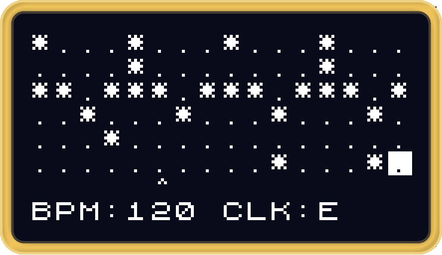

# STITCH — A-RYTH-MATIK Gate / Trigger Sequencer Firmware



## Download firmware / Update your module

https://dl.modulove.io/arythmatik/#stitch-sequencer


**STITCH** is a fast, text-only, performance-oriented 6-track / 16-step trigger & gate sequencer firmware for the **Modulove A-RYTH-MATIK** hardware (Arduino Nano / ATmega328P or LGT8F328P Nano board).

It combines **classic step programming** with **preset banks**, **repeat/switch automation**, **fill scheduling**, and **one-shot generative tools**—while keeping timing tight (PCINT external clock + Timer1 internal clock) and the UI extremely lightweight (U8x8, no framebuffer).

---

## Quick Overview

- **6 channels**, each driven by a 16-step pattern (stored as 16-bit masks).
- **Two modes**:
  - **MAN**: manually edit steps on a 6×16 grid.
  - **AUTO**: select preset banks + automatic switching + fills.
- **Output modes**:
  - **TRG**: 10 ms triggers on active steps
  - **GAT**: gates follow the step state (high for active steps)
  - **FF**: flip-flop toggle on hits (latched until next hit)
- **RST jack is assignable** (live): Reset, Fill, Generate, Mutate.
- **Secret menu** for hardware/UI defaults and a few persistent settings.
- **Serial control** (115200 baud) for pattern + configuration.

---

## Hardware / IO

### Inputs
- **CLK** (D13): external clock input (rising edge)
- **RST** (D11): external reset / action input (rising edge)
- **Encoder**: rotary + click (with pressed-rotation support)

### Outputs
- **CH1..CH6**: 6 digital trigger/gate outputs
- **LED1..LED3, LED6**: mirrored activity LEDs (LED4 and LED5 share their pins with the serial port and stay unused)

### OLED
- 128×64 SSD1306, **text mode** (U8x8)
- Optional **180° flip** in the secret menu (includes logical IO remap)

---

## Display / UI Basics

STITCH uses a simple, high-contrast text UI:

### Grid (Rows 1–6)
- 6 rows × 16 columns, showing step state:
  - `*` = active step
  - `.` = inactive step
- The **cursor** in the grid is shown by an inverted character cell.

### Caret (Row 7)
- A moving `^` indicates the **current step position** (updates on every step).

### Bottom Row (Row 8)
- Shows either:
  - **Scrollable menu bar** (when active), or
  - **Idle status/bar view** after a timeout (configurable).

---

## Navigation Model (One Encoder)

You always have a single selection cursor (`enc`):

- **Rotate encoder**: move cursor through
  - grid steps (1..96), then
  - bottom menu items
- **Click encoder**:
  - on grid: toggle step on/off
  - on menu item: perform that action / toggle that setting
- **Rotate while pressed**:
  - special behavior for **BPM** (fine adjustment while held)

> Tip: The bottom menu can scroll horizontally. STITCH keeps the selected item visible.

---

## Modes

### MODE: MAN (Manual)
In MAN mode you directly edit the 6 patterns.

- Grid editing is live and immediate.
- Bottom bar shows a reduced set of items (no STYLE item).

### MODE: AUTO (Preset / Performance)
AUTO mode uses preset banks and automated switching:

- Select a **STYLE** (preset bank) or **GEN** (generative).
- Use **REP** and **SW** to control when patterns change.
- Enable **FILL** and set **F-EV** to schedule fills.

---

## Bottom Menu Items

The bottom menu is context-aware (AUTO shows more items than MAN).

### MODE
Toggle between **MAN** and **AUTO**.

- When switching to AUTO, STITCH loads a preset (or generates in GEN).

### RESET
Hard reset the sequencer engine:
- step position resets
- outputs go low
- repeat/switch counters reset

### STYLE (AUTO only)
Select preset bank:
- `TC` = Tech
- `DB` = Dub
- `HS` = House
- `HF` = Half-time
- `GE` = Generative (algorithmic patterns)

### FILL
Enable/disable fill behavior.
- `FILL:Y` / `FILL:N`

### F-EV (AUTO only)
Fill period in repeats:
- `F-EV:1 / 2 / 4 / 8 / 16`

Meaning: every Nth repeat cycle, a fill is inserted.

### CLK
Clock source:
- `CLK:E` = external clock
- `CLK:I` = internal clock

### BPM
Internal clock tempo (only relevant when `CLK:I`):
- range: **60–240 BPM**
- click on BPM resets to **120**
- rotate while pressed changes BPM directly

### REP
Repeat token (how many full 16-step cycles before counting toward a switch):
- `REP:4 / 8 / 16 / 32 / ET`
- `ET` = endless (no automatic switching)

### SW
Switch span token (how many repeat blocks before switching to a new preset):
- `SW:2 / 4 / 8 / 16 / ET`
- `ET` = endless (no automatic switching)

### IN
Live action for the **RST jack**:
- `IN:R` = Reset
- `IN:F` = Fill
- `IN:G` = Generate
- `IN:M` = Mutate

This is a **runtime override**. A separate persistent default can be set in the secret menu.

### GEN
One-shot: generate a new algorithmic pattern set.

### MUT
One-shot: mutate the current patterns (small musical changes).

### OUT
Output mode:
- `OUT:TRG` = 10 ms triggers
- `OUT:GAT` = gates (step state)
- `OUT:FF`  = flip-flop toggle

---

## Fills Explained

STITCH has two fill systems depending on STYLE:

### Preset Banks (TC/DB/HS/HF)
Each preset provides two layers:
- **BASE** pattern (normal groove)
- **FILL** variant (more variation)

When fill is due, STITCH loads the FILL variant for one cycle, then returns to BASE.

### GEN Style (GE)
Fills are algorithmic transformations:
- densify hats
- add ghost snares / flips
- small rolls / accents
- alternating fill flavors

---

## RST Jack Actions (IN)

The RST input can be used as more than reset.

Set `IN:` in the bottom menu to choose what a rising edge on RST does:

- **Reset**: reset step position and clear outputs
- **Fill**: apply the GEN fill transformation to the current patterns at once (only with `STYLE:GE`; with the preset banks TC/DB/HS/HF it does nothing)
- **Gen**: generate a fresh pattern set
- **Mut**: mutate patterns in place

This makes the RST jack a **performance macro input**.

---

## Secret Menu

### How to Enter
- **On boot**: hold encoder button for ~3 seconds while powering on
- **During runtime**: hold encoder button for ~5 seconds

### Items
- **ROT**: OLED 0° / 180°
- **ENC**: encoder direction CW / CCW
- **CLK**: default clock source EX / IN
- **RIN**: default RST jack action (persistent default)
- **TMO**: UI timeout in seconds (1–30)
- **SAVE(Hold)**: save selected persistent settings and exit
- **FACT(Hold)**: factory reset all EEPROM settings

> Notes:
> - Rotating the OLED also remaps logical IO (CLK/RST and output channel order) so the module behaves correctly when physically rotated. When set in the secret menu, the display flips at once but the IO remap only takes effect after the next power-up.
> - Some values (like the live `IN:` selection) are intentionally runtime-only.

---

## EEPROM / Persistence

STITCH persists:
- current 6×16 patterns
- clock source + BPM
- mode (MAN/AUTO)
- style (bank)
- fill enable + fill period
- repeat/switch tokens
- output mode
- OLED flip + encoder direction
- UI timeout
- default RST action (secret menu)

To reduce clock jitter, writes are **deferred**:
- changes are written after ~2 seconds of inactivity.

---

## Serial Control (115200 baud)

STITCH exposes a compact serial protocol for automation, testing, and preset management.

### Pattern
- `P?`  
  returns: `P=hhhh,hhhh,hhhh,hhhh,hhhh,hhhh`

- `P=hhhh,hhhh,hhhh,hhhh,hhhh,hhhh`  
  sets pattern and saves to EEPROM

### Config Dump
- `C?`  
  returns:  
  `C=bpm,clk,mode,style,fill,rep,sw,enc,oled,rst,fper,out`

### Parameter Commands
- `B###`     BPM 60..240
- `K0/1`     Clock: 0=EXT, 1=INT
- `M0/1`     Mode:  0=MAN, 1=AUTO
- `S0..4`    Style: 0..3 banks, 4=GEN
- `F0/1`     Fill enable
- `R0..4`    Repeat token (4/8/16/32/ET)
- `W0..4`    Switch span (2/4/8/16/ET)
- `E0/1`     Encoder dir (0=CW, 1=CCW)
- `O0/1`     OLED flip (0/180)
- `N0..3`    Default RST action (persisted)
- `T0/1/2`   Output mode TRG/GAT/FF
- `G`        one-shot Generate
- `U`        one-shot Mutate
- `X`        simulate RST edge using current live `IN:` action
- `Q`        factory reset EEPROM

---

## Usage Recipes

### 1) Classic 4/4 Drums (Manual)
1. Set `MODE` to MAN.
2. Program CH1 kicks, CH3 snares, CH2 hats.
3. Set `OUT:TRG` for tight drum triggers.

### 2) Performance Auto Grooves
1. Set `MODE` to AUTO.
2. Choose `STYLE:TC` (or DB/HS/HF).
3. Set `REP:16`, `SW:4` (changes every 4×16 cycles).
4. Enable `FILL:Y`, choose `F-EV:4` (fills every 4 repeats).

### 3) RST as a Live “Break” Input
1. Set `STYLE:GE` and `IN:F` so RST triggers a fill (with the preset banks `IN:F` does nothing).
2. Hit RST to inject fills on demand.

### 4) Flip-Flop Latching Gates
1. Set `OUT:FF`.
2. Program steps as “toggle points.”
3. Useful for switching, mutes, logic, and long gate structures.

---

## Flashing

The easiest way is the [A-RYTH-MATIK firmware uploader](https://dl.modulove.io/arythmatik/#stitch-sequencer) in Chrome. The same file runs on an Arduino Nano and on LGT8F328P Nano boards; on an LGT8F328P board leave "Use new bootloader" unchecked.

Encoder direction and display rotation are set in the secret menu (`ENC`, `ROT`), not when building: STITCH does not use the `ENCODER_REVERSED` or `ROTATE_PANEL` options (the `reversed` release file behaves like the normal one).

Building it yourself (Arduino IDE or arduino-cli):
- Board "Arduino Nano"; for LGT8F328P boards choose the processor "ATmega328P (Old Bootloader)".
- Libraries: U8g2 (STITCH uses its U8x8 text mode), EncoderButton.
- `-DSSD1306_NO_SPLASH` (used for the other firmware) is not needed: STITCH does not use the Adafruit display library.
- Builds for LGT8F328P boards must stay below 29,696 bytes, see [AUTOMATED_BUILD.md](../../AUTOMATED_BUILD.md).

```
arduino-cli compile -b arduino:avr:nano --build-property upload.maximum_size=29696 ARYTHMATIK_Stitch
```

---

STITCH is part of the Modulove A-RYTH-MATIK firmware ecosystem and was mostly vibe coded.

---
